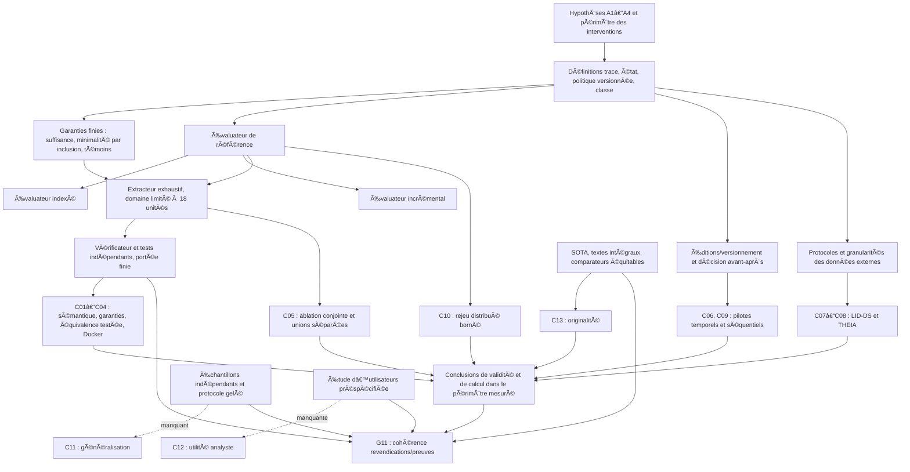

# Graphe des dépendances scientifiques — TracePolicy

**Date de travail :** 2026-11-28  
**Périmètre :** revendications C01–C13 de `claim_evidence_matrix.csv`, version de manuscrit et dépôt examinés lors de l’audit de révision.  
**État :** graphe initial établi; audit indépendant de chaque nœud amont et fermeture de G11 restent ouverts.

## Graphe de synthèse

## Dépendances par revendication

| Revendication | Dépendances nécessaires | Éléments présents | État de la chaîne et limite |
|---|---|---|---|
| C01 — sémantique déterministe versionnée | A1–A4; schémas événement/règle; priorité, classification, horizon; implémentation de référence | Manuscrit §§5–8; `formal/TracePolicy_Formal_Specification.tex`; `src/trace_policy_engine.py`; modèle-check fini | Soutenue dans le périmètre déclaré. Le replay explicatif utilise l’état initial vide; transitions et interfaces générales ne sont pas toutes établies. |
| C02 — suffisance et minimalité par inclusion | Domaine d’intervention fixé; oracle exact; monotonicité de la suffisance; test de chaque suppression; validité des témoins | Définitions et preuves finies dans la spécification; `min_explain_bruteforce`; vérifications de masques et témoins | Les preuves ensemblistes élémentaires sont cohérentes. La preuve exhaustive code/API est incomplète; aucun résultat ne signifie minimum global de cardinalité ou causalité physique. |
| C03 — équivalence des évaluateurs | Sémantique de référence; hypothèses d’indexation; hypothèses d’historique/transition; suites de tests et modèle indépendant | `reference_eval`, `StaticIndex`, `IncrementalEvaluator`; rapport formel; `scripts/independent_semantics_modelcheck.py` | Vérifié pour les tests et domaine fini généré. Couverture arbitraire de sélecteurs, mises à jour adversariales et interfaces d’état personnalisées ouverte. |
| C04 — procédures d’explication sur Docker | Cas sélectionnés et hachés; version de politique; cinq procédures; oracle exact; certificats de suffisance/minimalité | `results/revision/local_lab_proofmatched/`; tests; manuscript results | 120 alertes sélectionnées satisfont les contrôles indiqués. Dépendance aux fenêtres/alertes sélectionnées; aucune validation de déploiement indépendant. |
| C05 — ablation événements/règles/joint | Familles complètes de noyaux séparés; unions cartésiennes; évaluation dans le domaine conjoint; cas non sélectionnés et contre-exemple | `experiments/revision_joint_ablation_expanded_sample.py`; `results/revision/joint_ablation_expanded_sample_v1/`; `audit/COMPOSABILITY_ANALYSIS.md` | 335/335 unions de 239 alertes et 11/11 unions de neuf fixtures suffisantes; contre-exemple construit réfute l’universalité. Fréquence réaliste et utilité non établies. |
| C06 — explication de paire avant/après | Correspondance des versions; fonction à sortie paire; unités événement/édition; minimalité; oracle indépendant et baseline native | `experiments/revision_policy_differential.py`; résultat apparié; `audit/GENERIC_AXP_BASELINE_REPORT.md` | Trois fenêtres vérifiées exhaustivement; un énumérateur générique AXp reproduit les familles. Même sémantique et cas sélectionnés; preuve de mécanisme seulement. |
| C07 — résultat LID-DS | Données/scénario; protocole; split; unité d’analyse recording; labels; politique action seule | `results/lidds_cve_2020_23839/label_metrics.json`; protocole de données | Résultat descriptif sur un scénario et un split (120/120 enregistrements avec attaque alertés). Pas d’alignement à l’instant d’exploitation ni de portée générale. |
| C08 — résultat THEIA | Dérivé chronologique; labels proxy; politique de référence et variante; unité event-proxy; métriques recalculées | `temporal_external/results/detection_metrics.json`; rapport externe | La variante temporelle ajoute des positifs et faux positifs et présente un F1 proxy plus faible dans cette campagne. Résultat défavorable descriptif, une campagne familière. |
| C09 — séquence BETH | Règle/séquence; hôte; labels disponibles; provenance train/validation; sélection des alertes | `results/beth_p2_trainval_2026-11-04/`; rapport BETH | Sept explications exploratoires sélectionnées avec informations train/validation; tous les événements ont `evil=0`. Ne valide pas la détection d’attaque. |
| C10 — rejeu distribué | Ordonnancement, identifiants, checkpoints, synchronisation, scénarios de perturbation et oracle | `audit/two_source_replay.json`; campagnes WSL2/VPS indiquées dans le gap register | Soutient seulement les scénarios de laboratoire documentés. Les perturbations et conditions de déploiement générales ne sont pas couvertes. |
| C11 — généralisation | Holdout indépendant, unités d’échantillonnage préspécifiées, campagnes/hôtes/politiques distincts, protocole sans fuite | Jeux hétérogènes nommés dans l’article | Dépendance manquante : aucun échantillon représentatif indépendant. Le graphe n’autorise que « évalué sur ces représentations », pas « généralise ». |
| C12 — utilité analyste | Étude utilisateur préspécifiée, tâches, critères, population, comparaison et analyse | Aucun artefact d’étude identifié | Dépendance absente; ne pas revendiquer amélioration de compréhension, forensic ou performance analyste. |
| C13 — originalité | SOTA texte intégral; correspondance sémantique; baseline directe même tâche; propriété nouvelle ou utilité mesurée | `audit/SOTA_SYSTEMATIC_REVIEW.md`; matrice; collisions AXp/Margrave | Dépendances partiellement présentes, mais preuve d’une différence scientifique significative absente. Reste un risque éditorial ouvert. |

## Conséquences pour le manuscrit et le statut

1. Les résultats C01–C10 sont des conclusions subordonnées à leurs périmètres de données, d’interventions et d’implémentation; ils ne permettent pas d’inférer C11 ou C12.
2. Le passage de C02 à une revendication d’originalité C13 ne découle pas de la validité formelle. La minimalité et l’énumération exhaustive relèvent d’un cadre générique; une propriété propre à la classe de politiques doit encore être démontrée.
3. C05 montre qu’une composition naïve peut échouer dans un témoin construit, tandis qu’elle réussit dans les échantillons mesurés. Ces deux dépendances doivent être conservées ensemble dans toute conclusion.
4. C06 est logiquement distinct de l’explication d’une classe unique, mais son énumération est reproduite par un AXp générique sur la sortie paire. La distinction des unités reste une hypothèse de contribution, pas une preuve d’avantage.
5. G11 reste **NOT VERIFIED** jusqu’à la revue par un second passage de chaque dépendance amont et jusqu’à la synchronisation exacte de ce graphe avec le snapshot et les revendications du manuscrit.

## Vérification suivante requise

Reprendre chaque arête à partir du code, des données/résultats bruts et du texte du manuscrit sur un commit unique; consigner les divergences comme corrections ou restrictions de revendication. En particulier, vérifier les sources primaires de C03–C10 et les correspondances détaillées de C13. Ce graphe est un registre d’audit, pas une preuve que ses dépendances sont toutes satisfaites.

